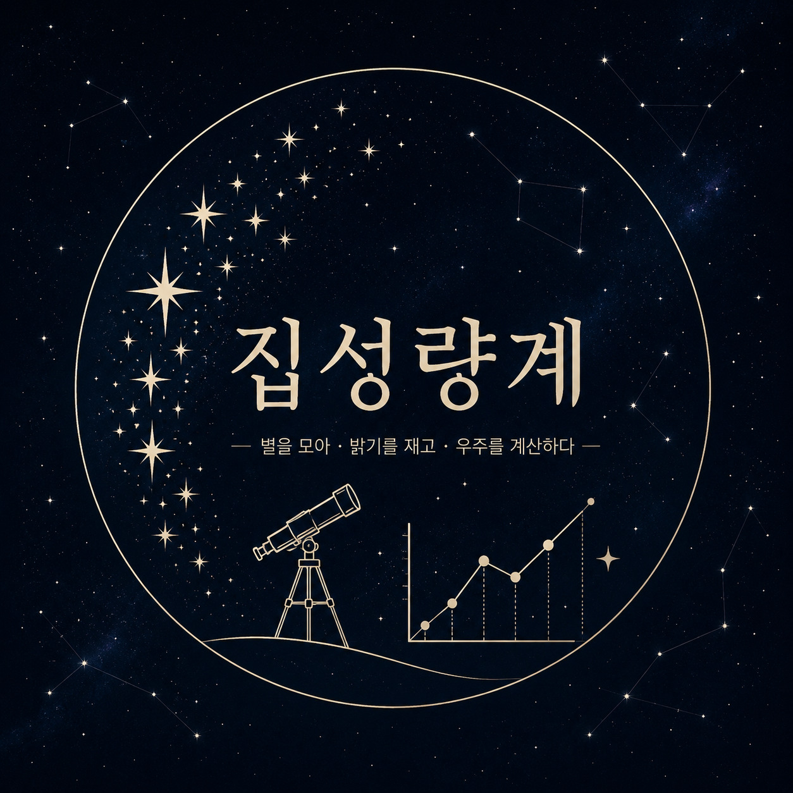
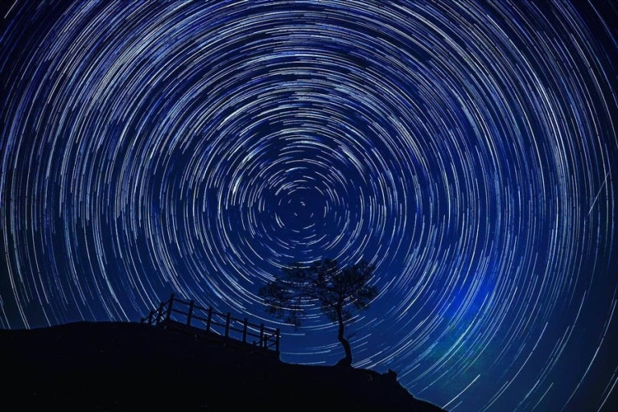

[index (2).html](https://github.com/user-attachments/files/33495818/index.2.html)
<!DOCTYPE html>
<html lang="ko">
<head>
<meta charset="UTF-8">
<meta name="viewport" content="width=device-width, initial-scale=1.0">
<meta name="theme-color" content="#020817">
<title>집성량계 | 대성고등학교 천문 동아리</title>

</head>
<body>

<nav>
  
集星量計

  <button onclick="home()">메인</button>
</nav>

<main id="homePage">
<section>
  <h2 class="title">메인 페이지</h2>
  
동아리 로고와 북극성을 중심으로 천문학을 알아갑니다.

  

    <article class="card">
      

      <h2>집성량계 로고</h2>
      
별을 관측하는 데서 그치지 않고 별과 우주를 직접 탐구하고, 천문학과에서 배우게 될 내용을 미리 경험한다는 의미를 담은 로고입니다.

    </article>
    <article class="card">
      

        
        
★

      

      <h2>북극성</h2>
      
북극성은 지구의 북쪽 하늘에서 거의 움직이지 않는 것처럼 보이며 방향을 찾는 기준으로 오랫동안 이용되어 온 별입니다. 현재의 북극성은 작은곰자리의 폴라리스입니다.

    </article>
  

</section>
<section class="hero">
  

    
  

  
대성고등학교 천문 동아리

  <h1>集星量計</h1>
  
모을 집 · 별 성 · 헤아릴 량 · 셀 계 
  별을 모아, 밝기를 재고, 우주를 계산하다.

  <button class="btn" onclick="showZodiacList()">다음 → 황도 12궁</button>
</section>

<section>
  <h2 class="title">동아리 소개</h2>
  

    

      대성고등학교 학우분들은 천문학과를 지원할 때 별을 관측하는 것만 생각하고 입학하여
      대학교 2, 3학년 때 당황하거나 전과를 선택하는 일이 없도록, 그리고 친구가 천문학과를
      목표로 한다고 하였을 때 점성술과 혼동하지 않도록 이를 알리고자 합니다.
    

    

      또한 천문학과를 선택하여 대학교에 입학했을 때 어떤 것을 배우게 되는지 미리 경험하고
      알아가는 시간을 동아리원들과 함께 나누고자 이 동아리를 만들려고 합니다.
    

  

</section>
</main>

<section id="zodiacPage" style="display:none">
  <h2 class="title">황도 12궁</h2>
  
별자리를 클릭하면 사진과 설명, 성격, 응원 메시지를 확인할 수 있습니다.

  

</section>

<section id="detailPage" style="display:none">
  

    

    

      <h2 id="detailName"></h2>
      

      
<h3>설명</h3>

      
<h3>성격</h3>

      
<h3>응원 메시지</h3>

      

        <button class="btn" onclick="showZodiacList()">← 목록</button>
        <button class="btn" onclick="nextZodiac()">다음 →</button>
      

    

  

</section>

<section id="surveyPage" style="display:none;width:100%;margin-left:auto;margin-right:auto">
  

    

      <h2 class="title">만족도 조사</h2>
      
집성량계 홈페이지를 둘러본 후 의견을 남겨주세요.

      

        <h3>콘텐츠가 재미있었나요?</h3>
        

          <input id="f5" name="fun" type="radio"><label for="f5">★</label>
          <input id="f4" name="fun" type="radio"><label for="f4">★</label>
          <input id="f3" name="fun" type="radio"><label for="f3">★</label>
          <input id="f2" name="fun" type="radio"><label for="f2">★</label>
          <input id="f1" name="fun" type="radio"><label for="f1">★</label>
        

      

      

        <h3>디자인은 만족스러웠나요?</h3>
        

          <input id="d5" name="design" type="radio"><label for="d5">★</label>
          <input id="d4" name="design" type="radio"><label for="d4">★</label>
          <input id="d3" name="design" type="radio"><label for="d3">★</label>
          <input id="d2" name="design" type="radio"><label for="d2">★</label>
          <input id="d1" name="design" type="radio"><label for="d1">★</label>
        

      

      

        <h3>남기고 싶은 말</h3>
        <textarea placeholder="자유롭게 의견을 적어주세요."></textarea>
      

      <button class="btn" onclick="submitSurvey()">제출하기</button>
    

    

      <h2 class="title">감사합니다.</h2>
      
여러분의 의견은 더 좋은 집성량계를 만드는 데 도움이 됩니다.

      <button class="btn" onclick="home()">처음으로</button>
    

  

</section>

<footer>집성량계 · 대성고등학교 천문 동아리</footer>

</body>
</html>
